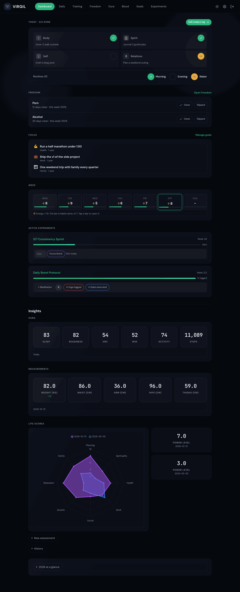
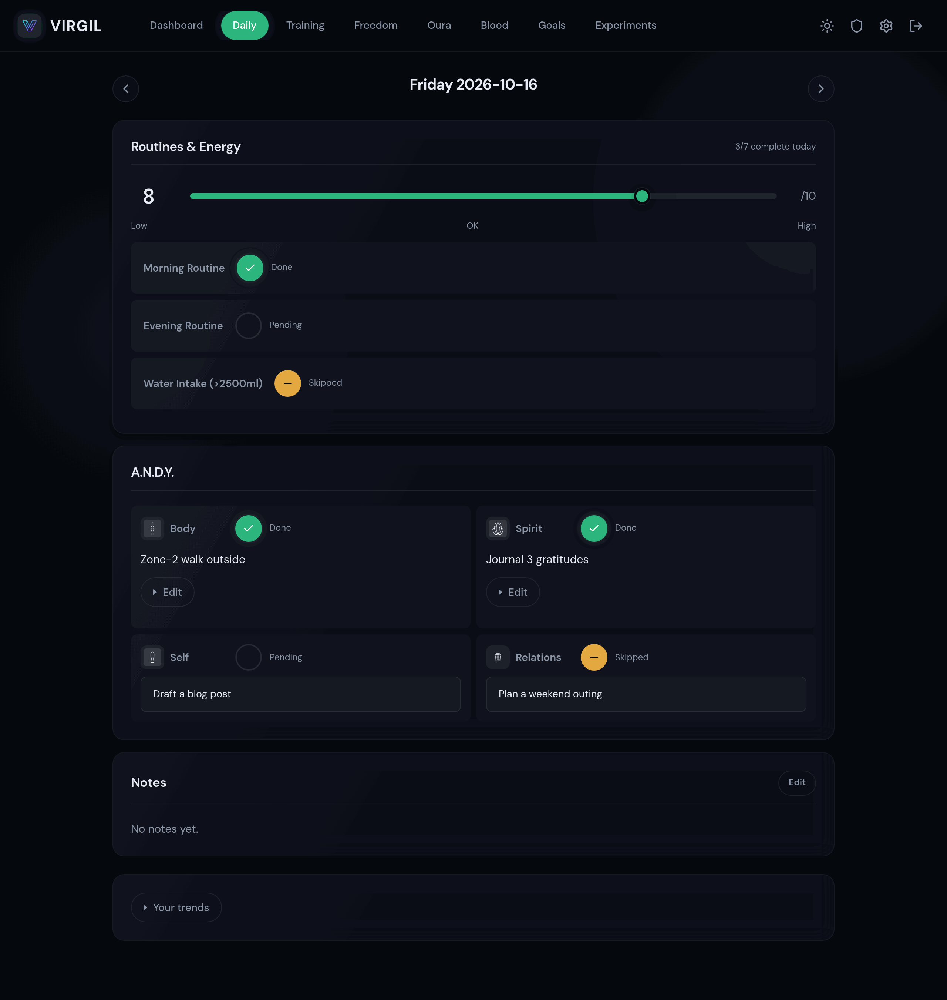
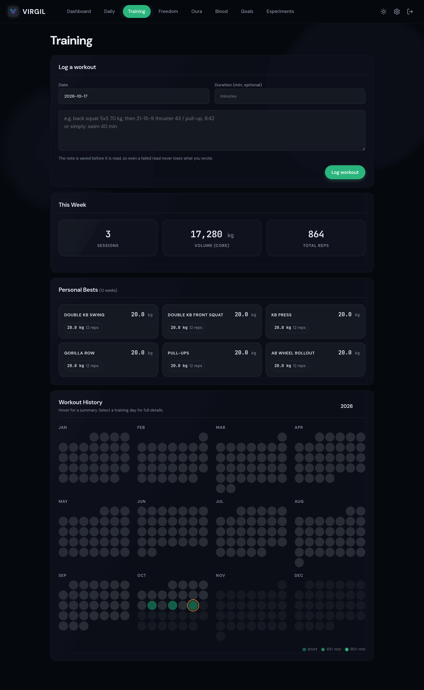
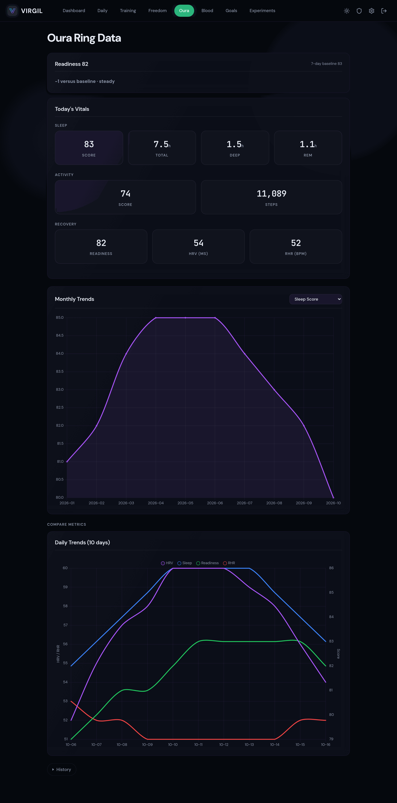
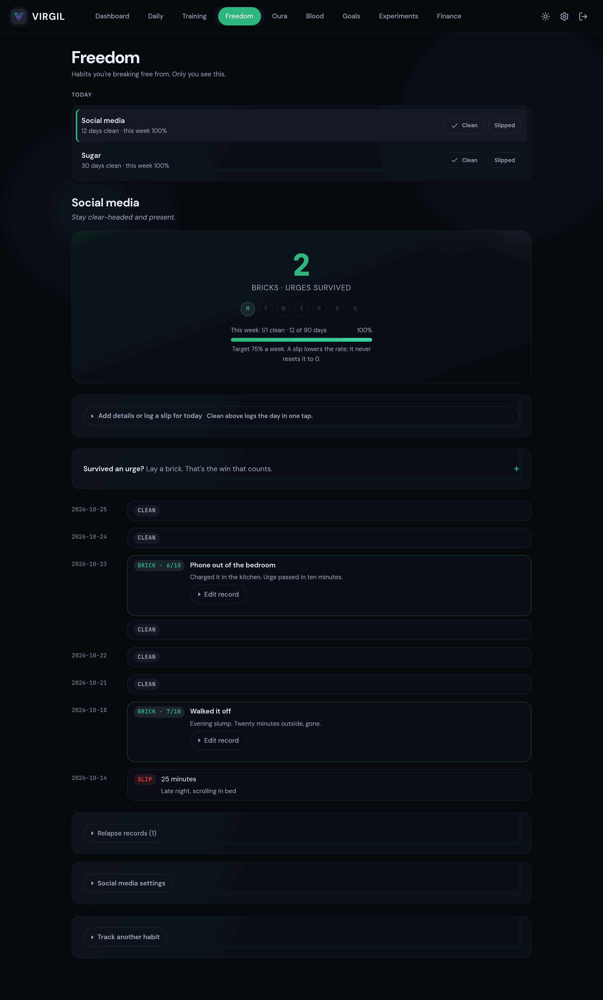
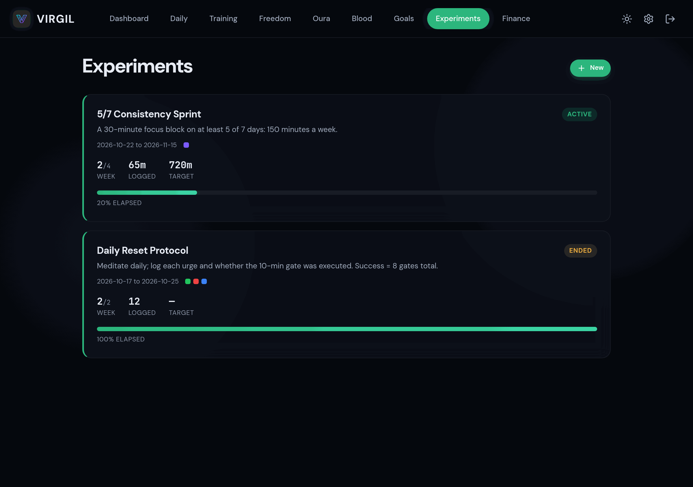

# Virgil

Personal life-tracking dashboard built with FastAPI, SQLite, Jinja2, and HTMX.

Virgil tracks daily habits, training sessions, health metrics, goals, experiments, and personal development programs, all through a mobile-friendly UI in English or Polish with dark/light theme support. Data lives in SQLite (source of truth) with on-demand markdown export for LLM-based reviews.

> **[CHANGELOG](CHANGELOG.md)** | **[Roadmap (issues)](https://github.com/krzysztofbury/virgil/issues)** | **[SPEC](SPEC.md)** | **[CONTRIBUTING](CONTRIBUTING.md)** | **[SECURITY](SECURITY.md)**

## Screenshots

<sub>All screenshots use the built-in demo seeder (`scripts/seed_demo.py`) - fictional data, no real user information. Desktop, dark theme, regenerated by `scripts/screenshots.py`.</sub>

<table>
<tr>
<td width="50%"><br><sub><b>Dashboard</b> - today's A.N.D.Y. tasks and routines tapped in place, focus goals, the week, then Insights</sub></td>
<td width="50%"><br><sub><b>Daily</b> - energy, routines and A.N.D.Y. tasks (AI-suggested), with a stated n/7 count</sub></td>
</tr>
<tr>
<td width="50%"><br><sub><b>Training</b> - free-text capture, grouped PBs, and calendar history</sub></td>
<td width="50%"><br><sub><b>Oura</b> - readiness against baseline, grouped vitals, monthly and daily trends</sub></td>
</tr>
<tr>
<td width="50%"><br><sub><b>Freedom</b> - every habit you are breaking checked off in one tap, then one habit's bricks, day log and timeline</sub></td>
<td width="50%"><br><sub><b>Experiments</b> - metric-based protocols (minutes, counts, daily yes/no, 0-10 ratings) with one-tap logging</sub></td>
</tr>
</table>

## Tech Stack

- **Backend**: Python 3.14, FastAPI, aiosqlite
- **Frontend**: Jinja2 templates, HTMX, Alpine.js (CSP build), Chart.js, Lucide icons, all served from `app/static/vendor` (sources and hashes in `SOURCES.json`), with no CDN or Google Fonts request
- **Styling**: Custom CSS with dark/light theme via CSS custom properties
- **Database**: SQLite with WAL mode, versioned migration system
- **Auth**: Multi-user with per-user isolated SQLite databases, email + password + TOTP MFA
- **LLM Integration**: LiteLLM (supports Anthropic, OpenAI, Gemini, Mistral, Groq, Ollama, and more)
- **Charts**: Chart.js (line, bar, sparkline, radar, dual-axis) — theme-aware
- **PWA**: Service worker with offline support, installable on mobile

## Quick Start

### Local Development (uv)

```bash
# Install dependencies
uv sync --locked --extra dev --python 3.14.7

# Run the app (hot reload enabled, port 8123)
uv run python -m app
```

On first launch, navigate to `http://localhost:8123`, sign up at `/signup` (email + password) and complete the onboarding wizard; every account goes through it once. Registration is closed by default, but the **first** account can always be created (bootstrap owner); open it for more users with `VIRGIL_REGISTRATION_OPEN=true`.

`VIRGIL_ENV` defaults to `local` which enables hot reload. Set to `prod` to disable.

### Docker (Local)

```bash
docker compose up -d --build
```

### QNAP NAS Deployment

Virgil runs on QNAP via Docker with Cloudflare Tunnel for zero-port exposure:

```
Browser (virgil.example.com)
    |
    v
Cloudflare Edge
    |
    v  (outbound-only tunnel)
+------------------------------------------+
| QNAP NAS                                |
|  +-------------+    +-----------------+  |
|  | cloudflared  |<-->| virgil          |  |
|  | (tunnel)     |    | FastAPI + SQLite|  |
|  +-------------+    +-----------------+  |
|                          |               |
|                          |               |
|                     /data (DB)           |
|                     (read-write)         |
+------------------------------------------+
```

**Step 1: Create Cloudflare Tunnel**

1. Go to [Cloudflare Zero Trust](https://one.dash.cloudflare.com/) > Networks > Tunnels
2. Create a tunnel, copy the token
3. Add public hostname: subdomain `virgil`, domain `example.com`, service `http://virgil:8123`

**Step 2: Configure secrets**

```bash
cp .env.example .env
# Edit .env — fill in CLOUDFLARE_TUNNEL_TOKEN (required) and API keys (optional)
```

**Step 3: First deploy (one-time)**

Production images are built by GitHub Actions on every push to `main` and pushed
to GHCR (`ghcr.io/krzysztofbury/virgil`). The NAS only needs the compose file,
`.env`, and a `data/` directory — no repo checkout, no building on the NAS:

```bash
ssh <user>@<NAS_IP>
mkdir -p /path/to/virgil/data /path/to/virgil/backups && cd /path/to/virgil
# The container runs as uid 1000; it must be able to write both directories.
chown 1000:1000 data backups
# copy docker-compose.yml + .env here (once — they rarely change)
docker login ghcr.io          # PAT with read:packages — needed if the package is private
docker compose pull
docker compose up -d
```

> **QNAP Container Station**: its compose editor neither substitutes `${VAR}` nor
> reads `.env`. Either run `docker compose` over SSH as above (the containers
> still show up in Container Station), or paste `docker-compose.yml` into the
> editor with every `${...}` replaced by its literal value and recreate the
> application there. If the editor rejects the long-syntax backups mount, use
> the short form `- /path/to/virgil/backups:/backups`, and create the directory
> first: the short form silently creates a missing one owned by root, which the
> container cannot write.

**Deploys after that are automatic**: push to `main` → Actions runs locked checks and audits →
builds and smoke-tests the image (with `GIT_SHA` baked in for PWA cache-busting) → pushes to
GHCR → the `watchtower` container on the NAS notices the new `:latest` within
~5 minutes and recreates `virgil`.

> **Deployment semantics - know what this is**: Watchtower is best-effort
> auto-update, NOT a staged deployment. A broken image is deployed. Two
> signals cover what can then go wrong. A process that stops answering `/livez`
> turns the container unhealthy, and the `autoheal` service restarts it. A start
> that leaves any database unmigrated keeps `/healthz` at 503 and posts one alert
> to `ALERT_WEBHOOK_URL`; it is not restarted, because a restart cannot fix it
> and would cut off every other account each time. Autoheal posts each restart
> to the same URL. With `WATCHTOWER_NOTIFICATION_URL` set, Watchtower also
> reports each deploy, and each poll while an update keeps failing (a registry
> login that expired, for example). A rollback is deliberately not automatic: database migrations are one-way and an older image
> refuses a newer database, so going back means restoring a **pre-migration
> snapshot** from `backups/pre-migration/` (`*-pre-migration-vNNN.db`), as the
> rollback procedure below describes. The CI test gate in front of every image
> remains the first safety net.
>
> **Backups live off the data volume**: compose mounts `VIRGIL_BACKUP_HOST_DIR`
> (default `./backups`) at `/backups`, separate from `./data`, so losing or
> wiping the data directory does not take the copies with it. Point it at
> another disk or share when there is one, with a Linux filesystem: backups are
> published by hard link, which exFAT and FAT do not support. Backups an older setup left in
> `data/backups/` are moved there at the next start. For copies off the machine,
> see [the recovery guide](docs/recovery.md).
>
> **Third-party images are pinned** by version and digest. Watchtower updates
> only `virgil`, so a cloudflared, Watchtower or autoheal upgrade is a reviewed
> edit to `docker-compose.yml` followed by `docker compose up -d`.

**Applying a `docker-compose.yml` change** (Watchtower only replaces the
`virgil` image, never the compose file): copy the new file to the NAS, create
any new host directory it mounts (writable by uid 1000, as above), then run
`docker compose up -d`. With Container Station, carry the same edits into its
editor, keeping your literal values, and recreate the application.

**Force an immediate update:**

```bash
docker compose pull virgil && docker compose up -d virgil
```

**Rollback:** pause Watchtower and pin a known-good `sha-*` image in Compose.
Follow [the rollback procedure](RELEASE.md#rollback), including database recovery
when the failed deployment applied migrations.

## Verification, releases, and recovery

[CONTRIBUTING.md](CONTRIBUTING.md) contains the exact local verification commands.
One CI workflow checks pull requests and main, qualifies the actual production
image, and publishes only after its smoke test succeeds. Version tags alias an
already verified main image and never change `latest`. See [RELEASE.md](RELEASE.md).

The [recovery guide](docs/recovery.md) covers complete offline bundles, integrity
verification, daily encrypted off-site copies to an S3-compatible bucket such as
Cloudflare R2, restore into a new directory, and a restore
drill. Per-user database downloads alone do not include the registry or encryption
key and are not whole-instance recovery artifacts.

The REST API and MCP take a credential in `X-API-Key` or
`Authorization: Bearer`. Each account creates its own **API tokens** under
Settings > Security: a token acts only for that account, with the scopes it was
given (`read`, `write`, `sensitive` for Freedom, `finance`), and can expire or
be revoked at once. The server's `VIRGIL_API_KEY` still works for the one
account named by `VIRGIL_API_USER_EMAIL`. To move off it, create a token with
the same scopes, put it where the key was, then remove both variables.

The MCP wrapper has its own committed dependency lock:

```bash
VIRGIL_API_URL=https://virgil.example.com VIRGIL_API_KEY=your-token \
  uv run --locked --script mcp_server/virgil_mcp.py
```

The app also serves the same tools over Streamable HTTP at `/mcp`, so a client
needs no checkout, `uv` or launcher. It takes the same credential as the REST
API; add the Cloudflare Access service-token headers when the host sits behind
Access:

```bash
claude mcp add --transport http --scope user virgil https://virgil.example.com/mcp \
  --header "Authorization: Bearer your-token" \
  --header "CF-Access-Client-Id: your-id" \
  --header "CF-Access-Client-Secret: your-secret"
```

The endpoint runs in stateless JSON mode; every tool still calls the REST API
(over loopback) with the caller's own credential, so `/mcp` and `/api` share
one auth path, one account mapping and one set of scopes.

Tests and Docker use bundled LiteLLM capability metadata for reproducibility.
Updating that metadata is part of a reviewed dependency update.

## Configuration

All configuration via environment variables:

| Variable | Default | Description |
|---|---|---|
| `VIRGIL_ENV` | `local` | `local` (hot reload) or `prod` (no reload) |
| `VIRGIL_CENTRAL_DB_PATH` | `./data/virgil-central.db` | Central user registry database |
| `VIRGIL_HOST` | `0.0.0.0` | Server bind host |
| `VIRGIL_BASE_URL` | `http://localhost:8123` | Public URL (for OAuth callbacks, webhook URLs) |
| `VIRGIL_ENCRYPTION_KEY` | (auto-generated) | Fernet key for encrypting secrets |
| `VIRGIL_ADMIN_EMAILS` | (empty) | Comma-separated admin emails (always have admin role) |
| `VIRGIL_REGISTRATION_OPEN` | `false` | Allow new user signups. The first account (bootstrap owner) can always be created |
| `VIRGIL_MAIL_BACKEND` | (empty) | Outgoing email: empty sends nothing, `smtp` sends through the server below, `log` writes each message to the log (development only). Sign-in links need it |
| `VIRGIL_SMTP_HOST` | (empty) | SMTP server for outgoing email (STARTTLS) |
| `VIRGIL_SMTP_PORT` | `587` | SMTP port |
| `VIRGIL_SMTP_USERNAME` | (empty) | SMTP login |
| `VIRGIL_SMTP_PASSWORD` | (empty) | SMTP password |
| `VIRGIL_MAIL_FROM` | (empty) | Sender, for example `Virgil <no-reply@example.com>` |
| `VIRGIL_MAIL_REPLY_TO` | (empty) | Optional Reply-To address for every email |
| `VIRGIL_TRUST_CLOUDFLARE_HEADERS` | `false` | Trust `CF-Connecting-IP` for rate limiting. Enable only when Cloudflare Tunnel is the sole ingress |
| `VIRGIL_TRUSTED_PROXY_IPS` | (empty) | Comma-separated proxy IPs or CIDR ranges allowed to supply `CF-Connecting-IP`. Behind the compose tunnel, use the `virgil-net` subnet: cloudflared changes address when recreated. Without trust, every visitor shares one rate-limit bucket, and the log warns the first time the header arrives untrusted |
| `VIRGIL_INTERNAL_LLM_MODEL` | `gemini/gemini-3-flash-preview` | Internal LLM for onboarding/system features |
| `VIRGIL_WORKER_WAKE` | `true` | Start a queued job at once instead of waiting for the next scheduler tick |
| `VIRGIL_INTERNAL_LLM_KEY` | (empty) | API key for internal LLM |
| `VIRGIL_API_KEY` | (empty) | Server API key for one account, beside each account's own API tokens: reads plus goal, rep, experiment-entry, exercise-library, daily-log, training, and measurement writes (the API is off while neither exists) |
| `VIRGIL_API_USER_EMAIL` | (empty) | The only account `VIRGIL_API_KEY` may read or write. Required when the key is set. Empty, missing, or deactivated returns 503 for `/api` and `/mcp` and does not fall back to another admin. The web UI keeps working |
| `VIRGIL_API_SENSITIVE` | `false` | Expose `/api/noporn` (intimate journal content), `/api/freedom`, the Freedom status in `/api/summary`, and the Freedom day-log, brick and habit-settings writes over the server API key. Tokens carry their own `sensitive` scope |
| `VIRGIL_API_FINANCE` | `false` | Expose `/api/finance` (account balances, the cushion, the score and their settings) and the Finance MCP tools over the server API key. Tokens carry their own `finance` scope |
| `CLOUDFLARE_TUNNEL_TOKEN` | (none) | Cloudflare Tunnel token (docker-compose only) |
| `VIRGIL_BACKUP_DIR` | `<data>/backups` (`/backups` in compose) | Where backups and pre-migration snapshots are written. Startup moves any left in `<data>/backups` here and logs an error when it is not writable |
| `VIRGIL_BACKUP_HOST_DIR` | `./backups` | Host directory compose mounts at `/backups` (docker-compose only). Must be writable by uid 1000 |
| `VIRGIL_ALERT_WEBHOOK_URL` | (empty) | URL that receives a JSON `{"text": ...}` post when a start leaves a database unmigrated. Compose fills it from `ALERT_WEBHOOK_URL` |
| `ALERT_WEBHOOK_URL` | (empty) | Compose only: the webhook for both the startup alert and each autoheal restart. Slack-style: it expects a `text` field |
| `WATCHTOWER_NOTIFICATION_URL` | (empty) | Compose only: a [shoutrrr](https://containrrr.dev/shoutrrr/v0.8/services/overview/) URL for a message per deploy. For the alert webhook, use `generic://` instead of `https://` and add `template=json&messagekey=text` to its query; Telegram has `telegram://<bot token>@telegram?chats=<chat id>` (see `.env.example`). An invalid URL stops Watchtower, so check its log for `Using notifications` |
| `TZ` | `Europe/Warsaw` (compose) | Time zone for every "today": streaks, today's entries and future-date checks. Unset means UTC, and startup logs a warning |

Port is always **8123**.

## Features

### Dashboard (`/`)

Action first, analytics after. The first block is **Today**: the four A.N.D.Y.
tasks and three routines, each tapped in place through `done > skipped > pending`
without opening Daily, with the count (`n/4`) and `Edit today's log` for
descriptions and notes. With Freedom on, a **Freedom** block marks each tracked
habit clean for today in one tap (a slip opens the habit's day form). Then the
morning briefing (if enabled), **Focus** (the starred goals), the week strip
(energy per day, with a legend) and active experiments, each card with its own
one-tap log for today. Everything that describes the past sits under **Insights** - Oura
vitals with when they last synced, body measurements, the life-score radar and
history - with the year calendar dot-matrix collapsed at the end.

History views share one set of windows: 4, 12 or 26 weeks, picked with `?weeks=`
(12 by default) on Life Scores, Oura's compare chart and daily history, and
Training's Personal Bests. The Daily heatmap stays at 12 weeks, which is what
fits a phone.

There is deliberately no interpretation sentence here: the page states the next
action and the numbers, and leaves the verdict to you.

### Daily Log (`/daily`)
- Energy level (1-10 slider) with `Low / OK / High` anchors
- `n/7 complete today` stated in the card header (three routines plus four A.N.D.Y. tasks), kept in step as you toggle
- Morning/evening routine toggles (three-state: done/skipped/pending) - each shows its state as a word and carries `aria-pressed`
- A.N.D.Y. task system — 4 life areas (Body, Spirit, Self, Relations) with toggle + description; a finished task with a description reads as content, with editing behind `Edit`
- A.N.D.Y. AI generation — uses configured LLM to suggest daily tasks based on goals, training, and weekly context
- Saturday body measurements (weight, arm, waist, hips, thighs)
- Markdown notes with edit/preview toggle
- Per-habit streak counters, the 7-day completion heatmap and a 12-week one, together under `Your trends`. The 12 weeks are a table: each day's count is read out by a screen reader, and each week's average is shown under its column
- Swipe left/right to navigate between days (mobile)
- Arrow keys to navigate between days (desktop)

### Training (`/training`)

One free-text note per session is the only input. Everything else on the page
reads back what was logged:

- Capture form - date, optional duration, and the note itself
- This Week KPIs - sessions count, total volume (Core, kg), total reps
- Correcting history: each set in a day's dialog has `Edit` (movement, set, reps,
  weight, time, equipment, note) and a confirmed delete, so a misread set is fixed
  without SQL and without deleting the whole workout
- Personal Bests - compact per-movement groups with records split by rep count or timed duration, over the shared 4, 12 or 26-week window (12 by default);
  a set on other equipment than the movement's usual one (a dumbbell hang snatch) is its own record
- `Unfinished` - every session whose parse is still waiting, whatever its date
- Year calendar history - duration heatmap with hover and keyboard summaries;
  selecting a training day opens bounded pages of its sessions, sets, notes,
  recovery actions, and delete actions. Navigation keeps every recorded year reachable.

The page previously carried a protocol table, a per-set log form generated from
it, and a rest timer. All three assumed a fixed prescription followed at home;
once training moved to a class that programs the session, the note became the
record and they were removed. The `training_exercises` table stayed — every
logged set references it — but it has no UI and no prescription role.

#### Capture — logging a workout from one note

Write one free-text note from memory after training and let it be parsed:

- **The note is saved before the LLM is called.** Parsing is derived and
  correctable; your own words are the source of truth. A parser failure — no
  provider configured, a timeout, a garbled reply, even a crash — costs you the
  structure, never the record.
- **The parser is confined to a closed movement vocabulary: every non-archived
  row in `exercise_library`** — your whole library, not a CrossFit-only slice
  of it. Movements carry free-form tags (e.g. `kettlebell`, `gym-classic`)
  instead of a single category, and tags organise the picker without gating
  what the parser may recognise: a session's warm-up, stretching, kettlebell
  or barbell work is picked up the same way a CrossFit movement is. A
  movement outside the vocabulary is reported as unrecognised, never
  invented — this is what stops the catalogue filling with `Thruster`,
  `thrusters` and `Thruster 43kg` as three separate exercises. Movement names
  are unique library-wide (migration 019), so there is no same-name-under-
  two-categories ambiguity left to resolve.
- **Nothing is written until you confirm.** The confirmation screen is editable:
  fix a misread weight, skip an entry you did not mean to log, or assign an
  unrecognised movement. The picker groups movements by section, shows their
  tags, puts what you logged recently first and can be filtered by name or tag;
  it stays a native `<select>`, so it works with no JavaScript and can only ever
  submit an exact library name. Refreshing the screen never re-invokes the LLM
  (the parse result is cached in `training_sessions.wod_parsed`), and
  re-submitting a confirmed session cannot double-count it.
- **A rejected field costs you that field, not the form.** An out-of-range value
  re-renders the screen with every other value you typed, the message naming the
  row and the field. Nothing is written and the parse stays armed for the retry.
- **A partial save says so.** If a movement no longer resolves, the rows that do
  are written and `/training` names what was skipped. A blank movement stays
  silent - that is the deliberate skip.
- **One capture per click** (`training_sessions.capture_token`, migration 024). A
  double submit, an F5 or a back-then-resubmit claims the same session and pays
  for one parse. A reused page carrying different text is a new capture, not a
  replay, so the back button cannot drop a note you just wrote.
- **A note that lost its parse can still gain entries.** A session left with only
  its text - a container recreated mid-parse, say - offers `Enter sets by hand`,
  which arms an empty parse and gives you the manual rows.
- **Movements you don't already train** are created with `ad_hoc = 1`: they count
  toward session history, weekly volume and Personal Bests. The flag is what keeps
  the daily-planner context clean of one-off movements.

The vocabulary is yours to curate — add, rename, delete it in
**Settings → App Config**, or over the REST API and MCP (see below). Renaming a
movement that already has logged history is refused, since it would split that
history across two exercises and halve your Personal Bests.

> Weekly volume is not comparable with pre-CrossFit numbers: metcon work counts
> as real Core volume, and a single 21-15-9 thruster couplet at 43 kg is ~1935 kg.
> That is intentional — see CHANGELOG.

### Freedom (`/freedom`)
Habits you are breaking free from. Hidden by default: enable **Freedom** in
Settings > General > Modules and tick the habits to track - porn, alcohol,
nicotine, cannabis, drugs, gambling, social media, sugar, or one in your own
words. Unticking a habit stops tracking it and keeps its history. The old
`/feniks` address redirects here.

- **Today** - every tracked habit with its streak and this week's clean rate,
  checked off as *Clean* or *Slipped* in one tap
- **One habit at a time** below it: its why, the bricks hero (urges survived)
  with a Monday-to-Sunday week strip, the day log, brick capture and the timeline
- **Each habit defines its own slip** - the button label (*I watched*, *I drank*),
  an optional amount with a unit and threshold, an optional near miss, and a
  written definition shown above the day question. Porn keeps the old measurement
  contract: watched means at least five total minutes of intentional viewing,
  shorter exposure stays clean and belongs in the note, and the near miss is
  edging. Everything is editable under the habit's settings
- **Bricks** - one distinct decision episode resolved before a slip; each carries
  a required memory hook, craving (0-10) and a short story (Gola's brick method),
  and can be edited or removed with confirmation
- **Day log** - marking a slip records that habit's relapse event once; correcting
  the day back to clean removes only that marker and clears slip-only fields
- **Weekly clean rate** - a slip lowers the week's rate (target 75%) and never
  resets it to zero
- **Timeline** - days and their bricks together, newest first. A day's date opens
  it in the day form, which can also delete a logged day
- **Relapse records** - what the streak is counted from, listed per habit. A
  record a slipped day wrote is corrected through that day; any other (older or
  imported) edits its date, type and note, or is deleted after a confirmation

Migration 034 moves No Porn history - days, bricks, relapse events, start date,
target and why - onto a Porn habit.

### Oura (`/oura`)
Daily and monthly Oura Ring metrics — sleep, readiness, activity, HRV, stress, and more.

- **API Integration**: OAuth2 connection to Oura Cloud for automatic data sync
- **Webhook Support**: Real-time data push from Oura with HMAC-SHA256 signature verification
- **Readiness vs baseline**: the page opens on today's readiness against the mean of the previous 7 days, the signed delta and one word (`above`, `steady`, `below`, at a 3-point tolerance). A rule over stored numbers - no generated advice and no LLM call
- **Today's Vitals**: grouped into Sleep, Activity and Recovery - sleep score, activity, steps, readiness, HRV, RHR, stress/recovery minutes. Activity and steps fall back to yesterday's values (with label) when today's data isn't yet available from the API
- **Compare metrics**: the dual-axis chart (HRV/RHR + sleep/readiness scores) over the shared 4, 12 or 26-week window, last on the page because it answers a different question from the default trend
- **Daily History**: Browsable table over the same window
- **Freshness**: the page says when Oura data last synced, in amber once that is over a day ago
- **Monthly Trends**: Aggregated averages with Chart.js trend charts
- **Manual Entry**: Fallback form for entering monthly averages
- **Rate Limit Handling**: 429 responses trigger exponential backoff with Retry-After

### Bloodwork (`/bloodwork`)
Blood test results organized by marker category with reference ranges, flag indicators, and per-marker trend charts.

On a phone each marker is one row - latest value, H/L status and the signed
change from the result before it - with the full date matrix under `All results`.
A marker's chart view lists its results under `Correct ... results`: each one's
date, value, text and flag can be fixed, or the result deleted, without SQL. The
flag is recomputed from the reference range unless a lab flag is chosen.
A wide screen gets the matrix directly. One Jinja macro renders both, so the two
views cannot drift apart.

### Life Scores (`/life-scores`)
Periodic self-assessment across 8 life areas with power level composite score and radar chart visualization. On the dashboard, `Over time` charts the power level across the shared 4, 12 or 26-week window (each area one legend tap away), and `History` lists every assessment in it, complete or not.

### Goals (`/goals`)
Canonical goals and one-off execution reps across 8 life areas with 1yr/3yr/10yr horizons.

- **Current focus** - star a goal from any area or any horizon to bring it here.
  The limit is advisory: above three the page says so and still saves the fourth,
  because a cap that refuses a write is worse than a crowded list
- **One horizon at a time** behind a switch, instead of all three at once
- Areas with nothing in the selected horizon render as one compact line each
- **One `Add goal` flow** that asks for the area and the horizon, replacing the
  24 always-open inputs the empty state used to render
- Goal status and start/end windows make active, paused, completed, and abandoned
  outcomes explicit
- **Execution reps** carry a day/week/month/quarter/year period, due date, and
  pending/completed/carried/skipped state. Carrying preserves the old record and
  creates the next pending rep. Calendar weeks always run Monday through Sunday
- Repeated metrics remain experiments, which can optionally link back to a goal;
  one-off calendar commitments remain reps rather than fake experiment counters
- REST and MCP 2.x provide bounded goal/rep reads plus idempotent create, update,
  delete, complete, carry, and skip writes
- **Undo a delete**: a deleted goal (one without reps, as before) waits under
  `Recently deleted` for 30 days with a `Restore` button, from the page, REST or
  MCP alike. Restoring brings back its id, text, focus and dates, and relinks the
  sub-goals and experiments the delete unlinked unless they were relinked since
- **Changes** under a goal's details: created, edited (which fields, and the
  status move), focus on or off, deleted and restored, newest first and capped
  at 20 per goal. Field names only, never the old text

### Experiments (`/experiments`)
Time-boxed experiments over 1..N tracked **metrics**. Each metric has a kind:

| Kind | Logs | Example |
|---|---|---|
| Minutes (`duration`) | minutes per session, Oura auto-import | "Zone 2" 180–210 min/week |
| Count (`count`) | events, one tap (`+1` + optional note) | "Gate executed" ≥8 total |
| Yes/No (`boolean`) | one check per day (last write wins) | "Meditation" every day |
| Rating 0-10 (`scale`) | quick 0-10 entries | "Craving before" |

- Weekly min–max minute targets (with per-week labels like DELOAD) for duration metrics
- Per-metric targets for count/yes-no metrics: value per day / week / whole experiment
- One-tap **Today** quick-log bar; day-grid shows minutes fills plus per-metric markers
- Full **edit** page (any status — active/completed/abandoned): basics, status, metrics
- Detail page asks one question: the one-tap `Today` log stays on screen and the
  full form sits behind `Different date or more detail` (open when a
  duration-only experiment has no one-tap path). The stats bar is outcome, target
  and `DAYS LEFT`, with `Week n of m` below it; Complete/Abandon/Delete live
  behind `Actions`
- `% elapsed` on the list counts days, not completed weeks
- AI-generated weekly summaries (kind-aware)
- Logging via MCP/REST: `log_experiment_entry` → `POST /api/experiments/{id}/entries`; exercise
  dictionary CRUD via `get_exercise_library`, `add_exercise`, `update_exercise`, `delete_exercise`
  → `GET/POST /api/library`, `PATCH/DELETE /api/library/{id}`
- Day check-in via MCP/REST, for an agent that talks the day through instead of
  opening the forms:
  - `log_daily` → `PUT /api/daily/{date}` merges only the supplied fields: energy,
    routines, and the four A.N.D.Y. statuses and descriptions
  - `get_habits` → `GET /api/freedom` lists every tracked habit with its slug,
    streak, this week, today's entry, bricks, slip definition and settings
  - `log_freedom_day` → `PUT /api/freedom/{habit}/days/{date}` and `add_brick` →
    `POST /api/freedom/{habit}/bricks` keep the Freedom form's contract (the
    relapse marker follows the outcome; for Porn, a slip is at least 5 minutes)
  - Every Freedom call requires the `sensitive` scope (`VIRGIL_API_SENSITIVE=true` for the server key)
  - `log_training` → `POST /api/training/sessions` writes a session and all its
    sets in one transaction; an unknown movement refuses the write and lists the
    names. `update_training` / `delete_training` → `PATCH/DELETE
    /api/training/sessions/{id}`; sending `entries` replaces every set
- Completing CRUD for the same records:
  - `get_daily` / `delete_daily` → `GET/DELETE /api/daily/{date}`
  - `delete_freedom_day` → `DELETE /api/freedom/{habit}/days/{date}`,
    `update_brick` / `delete_brick` → `PATCH/DELETE /api/freedom/bricks/{id}`,
    and `update_habit` → `PATCH /api/freedom/{habit}` (name, slip definition,
    start date, target days, why)
  - **Deprecated, kept for one release:** the No Porn names still work.
    `/api/feniks/daily/{date}`, `/api/feniks/bricks[/{id}]` and
    `/api/feniks/config` take an optional `?habit=` (default: the first tracked
    habit) and the old fields `used`, `minutes`, `edging`; the MCP tools
    `log_feniks_day`, `delete_feniks_day` and `update_feniks_config` call the
    Freedom ones
  - `get_training_session` → `GET /api/training/sessions/{id}`
  - `get_measurements`, `log_measurements`, `delete_measurements` →
    `GET /api/measurements`, `PUT/DELETE /api/measurements/{date}`, with the
    same bounds the daily form now applies

### Finance (`/finance`)
A household's financial resilience, without a bank integration. The user
defines a **fortress**: named layers (seeded as Cash cushion, Protection,
Independent income and Investments, all renamable), accounts in them, and
balances recorded once a month.

- Amounts are stored exactly, in minor units of one base currency (default
  PLN); an account in another currency may also keep its native amount
- A balance holds until the account's next one, so a month where one account
  was not updated still has a total and lists that account as stale
- Accounts can be `own`, `joint` or `excluded` (shown, never counted)
- Virgil computes the cushion (layers that count toward it), how many months of
  essential cost it covers (the cost that applied that month), the share of that
  cost covered by income independent of work and by all stable income, and a
  score from editable per-layer rules. Seeded rules: cushion 12/6/3/1 months for
  40/30/20/10 points, policies 35 (life 10, health 8, property 7, vehicle 5,
  income loss 5; not applicable leaves the total), independent income
  50/30/20/10% for 25/20/15/10. The score is given twice: with income independent
  of work only, and with all stable income. A missing input makes the score
  unknown, not zero
- The page (on under Settings > Modules) shows the cushion, its months, the
  score and the share covered by independent income, the cushion over time,
  each layer with its accounts, policies or income, and a "Record balances"
  form that starts at the latest balances. `/finance/setup` edits the layers
  and their rules (thresholds written as `12:40, 6:30`), accounts, essential
  cost, income and insurance
- MCP/REST, all behind the `finance` scope (`VIRGIL_API_FINANCE=true` for the server key):
  - `get_finance_overview` / `get_finance_history` → `GET /api/finance`,
    `GET /api/finance/history`
  - `record_balances` → `PUT /api/finance/balances/{date}`: a whole snapshot in
    one call, all or none; an unknown account refuses it
  - `upsert_finance_account` → `PUT /api/finance/accounts`
  - `set_finance_assumptions` → `GET/PUT /api/finance/assumptions`: essential
    monthly cost from a date, income sources, insurance policies, base currency
  - `get_finance_scoring` / `set_finance_scoring` → `GET/PUT
    /api/finance/scoring`: the layers and their score rules

### Settings (`/settings`)
Six-tab settings page:
- **General** - Interface language (English or Polski, kept on the account), database info, LLM provider management (add/activate/delete Claude, OpenAI, Gemini keys), the thinking level every AI call uses (`none`/`low`/`medium`/`high`/`xhigh`, default `medium`), feature flag modules (enable/disable optional modules like Freedom, with its habit checklist)
- **App Config** — Training schedule (which days are training days; what the A.N.D.Y. planner assumes) and the exercise library: the vocabulary the workout parser resolves notes against. Add your own entries, edit/delete them; built-in entries can be archived (hidden from the parser) but never edited or deleted. Over REST/MCP each entry also has a family (Snatch, Squat, Pull...), a default equipment and aliases such as "T2B" or "pistols"; matching is exact name, then alias, then unknown, never a nearest guess
- **Integrations** — OAuth2 connections (Oura Ring), webhook management, sync controls
- **Data** - Markdown download (weekly/monthly/yearly/all), JSON/CSV download, database backup
- **Automation** - Backup scheduling, Oura auto-sync interval, morning briefing toggle
- **Security** — MFA setup/disable (TOTP with QR code), sync log viewer

## Background work

No request waits on an LLM or on Oura. Backups, exports, Oura syncs and every
paid AI call are **durable jobs**: the route (or the scheduler) writes what you
asked for and returns; a bounded worker does the rest and survives a restart.

**Enqueueing starts the work immediately.** A job you asked for does not wait
for the next scheduler tick: the route wakes a bounded worker pass, so the click
is answered in milliseconds and the job is running a moment later. The 60-second
tick stays as the safety net for scheduled work and for anything a restart left
behind. Set `VIRGIL_WORKER_WAKE=false` to fall back to tick-only pickup.

**Paid AI work is treated differently from operational work.** Backups and syncs
retry themselves; a paid call does not. A timeout or an API error does not prove
the provider refused the request, so a second attempt could buy the same answer
twice. Those kinds get one attempt, an explicit manual retry, and a warning on
the card when the outcome is genuinely uncertain. A publication ledger records
what already reached you and outlives job pruning, so even a crash between the
write and job completion cannot cause a double charge.

| Kind | Retry | Triggered by |
|---|---|---|
| `backup`, `oura_sync` | automatic, bounded | manual button, schedule, Oura webhook |
| `morning_briefing` | manual | dashboard button, daily schedule |
| `wod_parse` | manual | saving a training note |
| `andy_generation` | manual | the AI button on Daily |
| `experiment_summary` | manual | the scheduler, one missing week at a time; or the per-week button |
| `onboarding_enrichment` | manual, per step | confirming onboarding |
| `medical_import` | manual | uploading a blood panel in onboarding |

Progress appears in the **notification tray** (top right). The tray polls
`/api/jobs/active`, so anything still queued or running is visible on every
page, not only where you started it, together with the outcome of whatever the
current page enqueued. Confirmations fade after a few seconds; errors and
unfinished jobs stay until you deal with them. Settings > Automation keeps the
full recent-job history with the same retry controls.

## UI/UX

### Dark/Light Theme
Toggle via the sun/moon button in the navigation bar. Theme preference is saved to localStorage (instant, no FOUC) and also stored server-side per user. All charts re-render with theme-appropriate colors.

### Keyboard Shortcuts
Press `?` to see the shortcut overlay. Navigation uses a `g` prefix:

| Shortcut | Action |
|---|---|
| `g d` | Dashboard |
| `g l` | Daily |
| `g t` | Training |
| `g f` | Freedom (when enabled) |
| `g o` | Oura |
| `g b` | Bloodwork |
| `g e` | Experiments |
| `g g` | Goals |
| `g s` | Settings |
| `<-` / `->` | Previous/next day (daily page) |
| `?` | Toggle shortcut overlay |
| `Esc` | Close overlay |

### Accessibility
- **Keyboard only**: the first Tab on every page offers `Skip to content`, past
  the navigation. Every control takes focus with a visible ring, nothing hidden
  can take focus (the phone `More` menu while closed), and `Esc` closes the menu,
  a day's training dialog or the shortcut overlay and returns focus to what
  opened it. A control that redraws itself after a tap keeps focus.
- **Reduced motion**: with the system setting on, nothing animates or
  transitions, scrolling jumps instead of gliding, and charts draw at once.
- **Charts**: each canvas is labelled for a screen reader and points to the
  table with the same numbers (Oura and Life Score history, all blood results);
  the life-score radar, which has no table, reads out its values.

### Navigation
Wide screens get the top navigation bar. On a phone a bottom bar holds what you
act on daily - Home, Daily, Training, and Freedom (Goals when Freedom is off) -
and `More` opens the read-mostly pages: Experiments, Oura, Blood, Settings, and
Goals when Freedom takes its place.

### Swipe Gestures
On mobile, swipe left/right on the daily page to navigate between days. Uses `data-swipe-left` / `data-swipe-right` attributes (80px minimum, 300ms maximum, horizontal > vertical).

### PWA / Offline
Virgil is installable as a PWA. The service worker provides:
- **Cache-first** for `/static/` assets, which include the vendored HTMX, Alpine.js, Chart.js, Lucide, Flatpickr and fonts
- **Network-only** for pages — authenticated HTML is never cached (privacy), offline shows the fallback page
- **Network-only** for POST requests (passthrough) — logging data requires a connection

When the connection drops on an open page, or a request to Virgil fails on the
network or gets a proxy's "cannot reach it" answer (502, 504, 520 to 530), a
banner says the page is read-only and every control that writes is disabled.
Reading stays as it was. The page checks every 10 seconds whether Virgil
answers again, then removes both without a reload; a sign-in page in front of
Virgil (an expired Cloudflare Access session) asks for a reload instead.

## Security

### Authentication
- Email + password with bcrypt hashing
- Optional TOTP MFA via `pyotp` + `qrcode`. The setup QR is generated for the signed-in user at `/mfa/qr.png`; the secret is not put in a URL, and responses that carry it are `Cache-Control: no-store`
- Signed cookie sessions via `itsdangerous.TimestampSigner` (7-day expiry)
- MFA-pending sessions blocked from protected routes; they expire after 10 minutes, and `/login` treats them as signed out
- A signed session whose account was deleted or disabled is cleared on the way to
  `/login`, instead of looping between `/` and `/login`

### Middleware Stack
Request processing order:
1. **Security Headers** - CSP with scripts only from `'self'` or inline with a per-response nonce (no `'unsafe-inline'` or `'unsafe-eval'` for scripts, no inline event handlers), X-Frame-Options, X-Content-Type-Options, Referrer-Policy, Permissions-Policy
2. **Rate Limiting** — 120 req/min general, 10 req/min for auth endpoints (per-IP sliding window)
3. **Authentication** — Cookie-based session verification (public paths: login, signup, MFA, offline, healthz, service worker, per-user Oura webhooks)
4. **Feature Flags** — Loads `feature_*` settings from `app_settings` into `request.state.features` for templates and route guards
5. **CSRF Protection** — Double-submit cookie on all POST forms (exempt: Oura webhook endpoint)

### Data Protection
- OAuth tokens and client secrets: Fernet-encrypted in database
- LLM API keys: Fernet-encrypted at rest
- Webhook secrets: stored in database, used for HMAC-SHA256 signature verification
- Encryption key: `VIRGIL_ENCRYPTION_KEY` env var, or auto-generated at `data/virgil.key` (0600 permissions)
- Server-side input validation on all form endpoints

## Database Migrations

Virgil uses a numbered migration system instead of `CREATE TABLE IF NOT EXISTS`:

- Migrations live in `app/migrations/NNN_name.py`, each exposing an `async def up(db)` function
- The `schema_migrations` table tracks applied versions
- On startup, `run_migrations()` discovers and applies pending migrations in order
- Each migration is committed individually and idempotent (safe to run on existing databases)
- Central registry migrations follow the same contract in `app/central_migrations/`
  and are tracked separately in `central_schema_migrations`

Current migrations:
| Version | Name | Description |
|---|---|---|
| 001 | `initial_schema` | Full schema + seed data (feniks config, goal areas, milestones, exercises, app settings) |
| 002 | `migrate_llm_api_keys` | Renames `api_key` to `api_key_enc`, encrypts plaintext values |
| 003 | `experiment_sources` | Adds `source`/`source_ref` columns and `source_match` for Oura workout import |
| 004 | `add_webhook_columns` | Adds `webhook_secret` column to `integrations` table |
| 005 | `feature_flags` | Seeds `feature_feniks=0` in `app_settings` (Feniks hidden by default) |
| 006 | `training_overhaul` | Adds `duration` column to entries, translates exercises to English, adds Stretching section |
| 007 | `litellm_model_strings` | Converts `llm_providers` rows to LiteLLM format (`anthropic/...`, `gemini/...`) |
| 008 | `onboarding` | Creates `user_profiles` table + `onboarding_completed` setting |
| 009 | `exercise_library` | Creates the user-editable exercise dictionary (now the parser vocabulary) |
| 010 | `rename_feniks_flag` | Renames `feature_feniks` to `feature_no_porn` |
| 011 | `exercise_metric` | Per-exercise `metric` ('reps' vs 'time') so timed holds don't pollute volume KPIs |
| 012 | `llm_provider_no_check` | Rebuilds `llm_providers` without the provider CHECK (unblocks anthropic/mistral/groq/ollama) |
| 013 | `training_exercise_archive` | Adds `training_exercises.archived` — deleting an exercise keeps history |
| 014 | `backup_default_on` | Flips `backup_enabled` to `1` on existing installs (backups become opt-out) |
| 015 | `general_experiments` | Metric kinds (duration/count/boolean/scale) + per-metric targets; `experiment_entries.value` replaces `duration_minutes`; `exercise_library.builtin`/`archived` flags |
| 016 | `crossfit_movements` | Adds `training_exercises.ad_hoc` to mark parser-created movements; seeds 31 CrossFit movements (vocabulary for WOD parser) |
| 017 | `crossfit_editable` | Makes the seeded CrossFit movements user-editable (`builtin = 0`) so they can be renamed/deleted, not just archived |
| 018 | `wod_parsed_cache` | Adds `training_sessions.wod_parsed` — caches the WOD parser result so Post/Redirect/Get never re-invokes the LLM on a refresh |
| 019 | `exercise_tags` | Replaces `exercise_library.category` with free-form tags (`exercise_library_tags` join table); makes `name` unique (`UNIQUE(name COLLATE NOCASE)`), merging same-name rows that used to coexist under different categories |
| 020 | `duration_seconds` | Converts `training_entries.duration` to canonical seconds |
| 021 | `air_squat` | Adds the missing bodyweight squat to the WOD vocabulary |
| 022 | `feniks_bricks` | Adds urge-survival bricks and the first single-flow Feniks schema |
| 023 | `feniks_single_flow` | Reconciles Feniks daily usage, bricks and legacy relapse history |
| 024 | `capture_token` | Adds idempotency tokens for WOD capture |
| 025 | `goal_focus` | Adds the advisory current-focus state to goals |
| 026 | `training_exercise_name_unique` | Merges safe race duplicates, preserves linked entries and makes movement resolution case-insensitively unique |
| 027 | `jobs` | Adds the per-user durable job queue: bounded payloads, idempotency keys, single-runner claims with lease tokens, persisted retry timing |
| 028 | `active_workload_jobs` | One queued job per operational workload kind (backup, export, Oura sync); reconciles v27 duplicates |
| 029 | `llm_publications` | Adds the paid-LLM publication ledger, which outlives terminal job pruning, and one queued job per paid kind |
| 030 | `feniks_measurement_contract` | Clears watched-only measurements left on clean Feniks days |
| 031 | `canonical_goals` | Adds canonical goal state, first-class reps and goal-linked experiments |
| 032 | `training_history_indexes` | Indexes training history summaries and selected-day details |
| 033 | `movement_taxonomy` | Adds movement families, aliases, default and per-set equipment; adds missing CrossFit variants and merges duplicate movements with their history |
| 034 | `freedom_habits` | Adds `habits`; keys day logs, bricks and relapse events by habit; moves No Porn history onto a Porn habit and renames `feature_no_porn` to `feature_freedom` |
| 035 | `drop_no_porn_leftovers` | Drops `feniks_config` (moved onto the Porn habit) and `feniks_milestones`; keeps the journal and pleasures |
| 036 | `english_labels` | Renames the seeded goal areas and the importer's blood-test categories to English; names the person chose stay |
| 037 | `drop_second_brain` | Removes queued markdown export jobs and the scheduled-export settings left from the Second Brain folder |

Central registry migrations:
| Version | Name | Description |
|---|---|---|
| 001 | `baseline` | Records the existing users and webhook routing schema as the central baseline |
| 002 | `provider_subscriptions` | Adds desired-state subscription registrations, item-level renewal metadata, fenced claims and user lifecycle leases |

## Data Model

### Central Database (`virgil-central.db`)
- `users` — identities, bcrypt password hashes, roles, TOTP secrets, per-user DB filenames
- `webhook_routes` — opaque webhook ids → user mapping for public Oura callbacks
- `provider_subscription_registrations` - provider-neutral desired state, reconcile status and claim fencing per user/provider
- `provider_subscription_items` - provider-owned remote identifiers and renewal metadata per subscription item
- `user_lifecycle_leases` - serializes subscription changes with credential replacement, disconnect, reset and account deletion

### Per-User Tables
- `schema_migrations` — applied migration versions
- `app_settings` — key-value configuration store (includes `feature_*` flags for optional modules)
- `daily_logs` — daily tracking entries
- `body_measurements` — Saturday weigh-ins
- `daily_briefings` — AI-generated morning briefings
- `training_exercises` — the row every logged set references; seeded, no longer a UI-managed protocol
- `training_sessions` + `training_entries` — workout logs
- `habits` - Freedom habits: slip label and definition, amount unit and threshold, near-miss label, start date, target, why, tracked flag
- `feniks_daily`, `feniks_bricks` - Freedom day logs and bricks, keyed by habit
- `pmo_events` - relapse/reset events, keyed by habit
- `feniks_journal`, `feniks_pleasures` - the No Porn program's journal and pleasures, read by `/api/noporn` and the markdown download
- `oura_daily` — Oura Ring per-day data (from API or webhook)
- `oura_monthly` — Oura Ring monthly averages (computed from daily or manual)
- `oura_workouts` — Oura workout data
- `blood_markers` + `blood_results` — lab results
- `life_scores` — periodic assessments
- `goal_areas` + `goals` — life goals
- `experiments`, `experiment_weeks`, `experiment_entries`, `experiment_activity_types` — experiments
- `experiment_summaries` — AI-generated weekly experiment summaries
- `integrations` — OAuth2 credentials + webhook secrets (Fernet-encrypted)
- `llm_providers` — LLM API key storage (Fernet-encrypted)
- `jobs` - the durable work queue: one row per unit of background work, with its status, attempts and lease
- `llm_publications` - which paid LLM results already reached the user; outlives job pruning so a retry cannot buy the same answer twice
- `sync_log` — export/sync audit trail

### Three-State Toggles
Habit and task items use a three-state cycle: `done` > `skipped` > `pending`, mapped to `[x]` / `[-]` / `[ ]` in markdown. On the dashboard each tap advances one item (`POST /daily/{date}/cycle`) and leaves the rest of the day as it was.

## Oura Ring Integration

Virgil connects to the Oura API v2 via OAuth2 for automatic daily health data sync, with optional webhook for real-time updates.

### Setup
1. Register an app at [cloud.ouraring.com/oauth/applications](https://cloud.ouraring.com/oauth/applications)
2. Set the redirect URI to `{VIRGIL_BASE_URL}/settings/oura/callback`
3. In Virgil Settings > Integrations, enter your `client_id` and `client_secret`
4. Click "Connect to Oura" and authorize access
5. Click "Sync Now" to pull the last 30 days of data

### Webhook (Real-time Sync)
1. In Settings > Integrations, click "Enable Webhook" on the Oura card
2. Virgil registers one subscription per handled `(event_type, data_type)` pair with the Oura API, using a **per-user callback URL** (`/api/oura/webhook/{id}`) that routes events to the right user's database
3. Oura sends a verification challenge — Virgil responds to complete registration
4. Subsequent data events trigger a 2-day sync window with HMAC-SHA256 signature verification against the user's encrypted webhook secret
5. The scheduler reconciles remote state, renews each subscription before expiry and retries degraded or interrupted work
6. To remove, click "Disable Webhook" - Virgil confirms remote teardown before credentials or user data can be replaced

Subscription orchestration is provider-neutral. The coordinator owns desired
state, bounded retries, leases and atomic publication; the Oura adapter owns
discovery, callback matching, renewal and teardown semantics. Settings reports
pending, active, partial, retrying and disabling states instead of treating a
partially registered webhook as fully active.

**Note**: Your `VIRGIL_BASE_URL` must be publicly reachable for Oura to deliver webhook events.

**Cloudflare Access**: if the site sits behind Access, add a **Bypass policy for the path `/api/oura/webhook/*`** — Oura's verification challenge (GET) and event deliveries (POST) are unauthenticated server-to-server calls and get bounced to the Access login page otherwise. The endpoint authenticates on its own: opaque per-user callback ids plus HMAC-SHA256 signatures.

Supported data types: `daily_sleep`, `daily_readiness`, `daily_activity`, `daily_stress`, `sleep`, `workout` (event types `create` + `update`).

### What Gets Synced
Daily data is stored in `oura_daily` (per-day) and aggregated into `oura_monthly` (averages):
- Sleep score, readiness score, activity score
- Steps, sleep duration, deep sleep, REM sleep
- Resting HR, lowest HR, HRV
- Stress (high) and Recovery (rest) — displayed in minutes

## Markdown Export

Settings > Data downloads a readable markdown summary, for reading or pasting into an AI assistant. It is built on request and nothing is written on the server. Choose the sections and the time range:

| Scope | Content |
|---|---|
| Weekly | Daily logs, training, Freedom habits (if enabled), measurements (current week) |
| Monthly | Weekly data + oura, life scores, experiments (current month) |
| Yearly | Monthly data + blood work, goals (current year) |
| All | Everything in the database |

## Project Structure

```
virgil/
├── app/
│   ├── __main__.py           # Entrypoint: uvicorn with reload (local) or without (prod)
│   ├── main.py              # FastAPI app, Jinja2 setup, markdown filters, SW route
│   ├── config.py             # Environment variable configuration (VIRGIL_ENV, port, paths)
│   ├── db.py                 # Schema constants, seeds, connection management
│   ├── auth.py               # AuthMiddleware (cookie session verification)
│   ├── csrf.py               # CSRF double-submit cookie middleware (with exempt paths)
│   ├── rate_limit.py         # Per-IP sliding window rate limiter
│   ├── security_headers.py   # Security response headers middleware (nonce-based CSP)
│   ├── validation.py         # Shared input validation helpers
│   ├── mcp_endpoint.py       # Hosted MCP over Streamable HTTP at /mcp
│   ├── migrations/
│   │   ├── runner.py         # Migration discovery + execution engine
│   │   ├── 001_initial_schema.py
│   │   ├── 002_migrate_llm_api_keys.py
│   │   ├── 003_experiment_sources.py
│   │   ├── 004_add_webhook_columns.py
│   │   ├── 005_feature_flags.py
│   │   └── 006_training_overhaul.py
│   ├── central_migrations/    # Versioned central registry migrations
│   ├── routers/
│   │   ├── auth.py           # /login, /signup, /logout, /mfa routes
│   │   ├── dashboard.py      # / route + sparkline data + /offline
│   │   ├── daily.py          # /daily routes + A.N.D.Y. AI generation
│   │   ├── training.py       # /training routes + exercise CRUD + KPIs
│   │   ├── freedom.py        # /freedom routes (and the /feniks redirect)
│   │   ├── oura.py           # /oura routes + daily trends
│   │   ├── oura_webhook.py   # /api/oura/webhook/{id} (HMAC-verified, CSRF-exempt)
│   │   ├── bloodwork.py      # /bloodwork routes
│   │   ├── life_scores.py    # /life-scores routes
│   │   ├── goals.py          # /goals routes
│   │   ├── experiments.py    # /experiments routes
│   │   ├── jobs.py           # /api/jobs status partial + explicit retry
│   │   └── settings.py       # /settings routes + theme API + webhook mgmt
│   ├── services/
│   │   ├── encryption.py     # Fernet encrypt/decrypt for secrets
│   │   ├── oura_api.py       # Oura OAuth2 + API v2 client + sync
│   │   ├── oura_subscriptions.py # Oura subscription lifecycle adapter
│   │   ├── subscriptions.py  # Provider-neutral lifecycle coordinator
│   │   ├── llm.py            # LLM API client (Claude/OpenAI/Gemini) + thinking level
│   │   ├── llm_jobs.py       # Paid-LLM durability: publication ledger, one-attempt producers
│   │   ├── jobs.py           # Durable job state transitions (enqueue/claim/complete/retry)
│   │   ├── job_producers.py  # Canonical producers for operational workloads
│   │   ├── job_handlers.py   # Trusted handlers, one per job kind
│   │   ├── job_worker.py     # Bounded execution, lease fencing, handler registry
│   │   ├── briefing.py       # AI morning briefing generation
│   │   ├── andy.py           # A.N.D.Y. daily suggestions (context + prompts)
│   │   ├── medical_import.py # Staged blood-panel upload, extraction and storage
│   │   ├── markdown_export.py # Scoped markdown download
│   │   ├── scheduler.py      # Background task loop (enqueues due work, runs the job worker)
│   │   ├── backup.py         # SQLite backup with rolling retention
│   │   ├── experiment_summary.py # AI weekly summaries for experiments
│   │   ├── habits.py         # Freedom habit catalog, tracking and settings
│   │   ├── freedom_log.py    # Freedom day logs, bricks and per-habit overview
│   │   ├── daily_log.py      # Daily-log persistence shared by forms, REST and the dashboard
│   │   └── streak.py         # Freedom streak and weekly clean rate per habit
│   ├── templates/
│   │   ├── base.html         # Layout with nav, theme toggle, SW registration
│   │   ├── offline.html      # Standalone offline fallback page
│   │   ├── auth_*.html       # Login, signup, MFA templates
│   │   ├── partials/         # HTMX partial templates
│   │   └── *.html            # Page templates
│   └── static/
│       ├── css/app.css       # Design system with dark/light theme via CSS vars
│       ├── js/app.js         # Theme toggle, keyboard shortcuts, swipe gestures, toggles, toasts
│       ├── js/charts.js      # Theme-aware Chart.js wrappers with chart registry
│       ├── service-worker.js # PWA service worker (cache-first, stale-while-revalidate, network-first)
│       ├── manifest.json     # PWA manifest
│       ├── icons/            # PWA icons + favicons
│       └── img/              # A.N.D.Y. icons + branding
├── data/                     # SQLite databases + encryption key (gitignored)
├── backups/                  # Backups and pre-migration snapshots in compose (gitignored)
├── docker-compose.yml        # Virgil + Cloudflare Tunnel (QNAP-compatible)
├── Dockerfile                # Python 3.14 + uv, prod mode
├── .env.example              # Environment variable template
├── pyproject.toml
├── CHANGELOG.md
├── SPEC.md
├── CONTRIBUTING.md
├── SECURITY.md
├── CODE_OF_CONDUCT.md
├── LICENSE
└── README.md
```

## Contributing

See [CONTRIBUTING.md](CONTRIBUTING.md) for development workflow, code style, and PR guidelines.

## License

[MIT](LICENSE)
